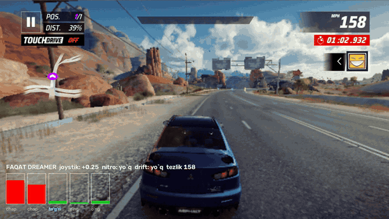
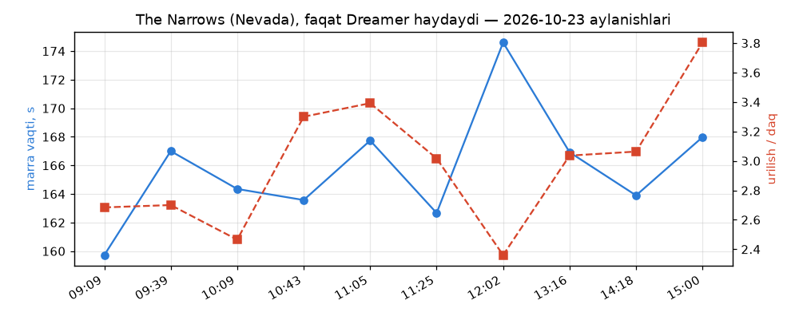
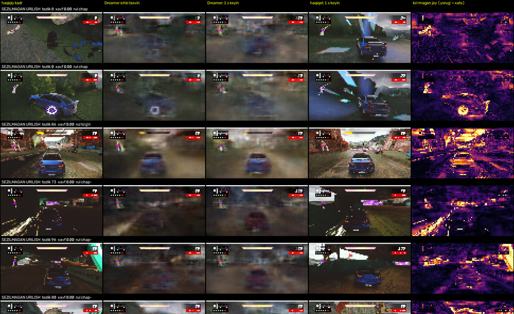

# Asphalt AI

Asphalt Legends uchun ekranni ko'rib o'ynaydigan AI. Trassaga emas, ko'rinadigan hodisaga bog'lanadi: ko'rish o'rganiladi,
shuning uchun tayyor AI istalgan trassada o'yinni o'zi baholab o'ynay oladi.

> **Holat: izlanish (research) bosqichida.** Bu tayyor mahsulot emas — tajriba loyihasi. Natijalar, kod tuzilmasi va
> yondashuv o'zgarib turadi; ba'zi skriptlar faqat muallif kompyuteri sozlamalariga (yo'llar, emulator, ViGEm) moslangan.



*Faqat Dreamer haydaydi (bot yoki odam yo'q): pastdagi ustunlar — 5 yo'nalish bo'yicha 1 s ichida urilish xavfi
(qizil = xavfli), yuqorida analog joystik qiymati, nitro va drift. Private Room, Nevada — The Narrows.*

## Hozirgi natijalar (2026-10-23)
| | |
|---|---|
| Trassa | Nevada — The Narrows (Private Room, bitta mashina: Mitsubishi Lancer Evolution X) |
| Boshqaruv | faqat Dreamer world model + reja tuzuvchi (36 reja: 9 joystik qiymati x drift x nitro), analog stik |
| Marra | aylanishlarda 60–100% |
| Marra vaqti | o'rtacha 160–168 s (eng yaxshi poyga 157.6 s) |
| Urilish | daqiqasiga 2.4–3.8 |
| World model (ko'rilmagan PCD1 poygalarida) | urilishni 1 s oldin sezish AUC 0.74, tiqilish AUC 0.99, tezlik xatosi 11.5 mph |



Ochiq muammolar (izlanish davom etyapti): devor bo'ylab "sirpanib" yurish (tezlik sekin tushadi, model buni xavf deb
sezmaydi), driftni uzoq ushlab turish, oldindan rejalash; haydash sifati world model ko'rsatkichlari bilan birga o'smayapti.

### Dreamer nimani ko'rmaydi


*`Vision/dream_diag.py` chiqishi: haqiqiy kadr | Dreamer ichki tasviri | Dreamer 1 s keyingi bashorati | haqiqat 1 s keyin |
xato xaritasi (yorug' = model ko'rmagan joy). Qatorlar — sezilmagan urilishlar.*

## Namunalar
```bash
# 1) Ma'lumot: poygalarni yozib olish (PC, yashirin oyna + virtual gamepad), faqat Dreamer haydaydi
py tools/pc_agent.py --tag N1023_test --races 5 --dream-only --dream-eps 0.1 --private

# 2) Yozuvlarni o'qitish to'plamiga yig'ish (data/ds2)
py Vision/build_ds2.py

# 3) World model'ni davom ettirib o'qitish (PCD1 tekshiruv uchun chetda qoladi, PC poygalari 50%)
py tools/safe_run.py 3000 -- py -u Vision/dreamer.py --steps 30000 --bs 8 --T 48 --resume --exclude PCD1 --pc-frac 0.5

# 4) Tekshiruv: urilish/tiqilish AUC, tezlik xatosi, ko'r nuqtalar rasmi -> data/diag_PCD1/
py Vision/dream_diag.py PCD1 cpu

# 5) To'liq tsikl: poyga -> yig'ish -> o'qitish -> tekshiruv (yomonlashsa qaytariladi), belgilangan soatgacha
py tools/overnight.py --until 20:00 --races 5

# poyga videosi (joystik/nitro/drift ko'rsatkichlari bilan): pc_agent --video 1 + tools/pc_video.py
```
`tools/safe_run.py` GPU yuklamasi/VRAM 80% dan oshsa jarayonni to'xtatadi (kompyuter qotmasligi uchun).

## Tuzilma
| Papka | Vazifa |
|---|---|
| `Core/` | Tezlik o'qigich (OCRsiz): Frame, Glyphs, Reader (raqam + foiz). Platformaga bog'liq emas |
| `Speed/` | Windows konsol: shablon o'rganish/nomlash/o'qish/bench (`MAXG=4` DIST uchun) |
| `App/` | Android APK (`space.asphaltai`): ekran oqimi, virtual gamepad, ko'rish, agent, yozuvchi |
| `Vision/` | PC'da o'rgatish: ko'rish kodlovchisi (CNN), yordamchi yorliqlar, baholash, reward audit |
| `tools/` | Emulator boshqaruvi (`devctl.py`), menyu navigatsiyasi (`flow.py`), o'rgatish tsikli (`cycle.py`) |
| `Depth/` | Tayyor chuqurlik/segmentatsiya tajribalari (hozir faqat yordamchi xususiyat + ONNX eksport) |
| `human data/` | Odam bilimi: harakatlar va burilish katalogi |
| `data/` | Yig'ilgan sessiyalar (`rec_<tag>.bin`, `agent_<tag>.csv`, ...) |

## Arxitektura
1. **APK** o'ynaydi va yozadi: har 250 ms da kichik kadr (96x48), HUD hodisa ustuni, nitro chizig'i, tezlik, DIST%, harakatlar, reward komponentlari -> `rec.bin` + `agent.csv`.
2. **PC** (`Vision/train.py`) kadrlardan **ko'rish kodlovchisini** o'rgatadi. Yorliqlar o'yinning o'zidan (qo'lda belgilash yo'q): to'qnashuv (1 s ichida tezlik yo'qotish), tezlik o'zgarishi, nitro o'sishi, HUD hodisa sinfi (klaster), kelajak reward.
3. Kodlovchi ONNX bo'lib APK assets'iga tushadi (`vision.onnx`, `vision.ver`). Agent (shoxlangan DQN, qurilmada onlayn) kodlovchi chiqargan vektor ustida o'rganadi: **ko'rish yoqiq bo'lsa tayyor segmentatsiya/chuqurlik kerak emas** (`ai eval` ularni o'chiradi).
4. `tools/cycle.py` yig'ish -> o'rgatish -> o'rnatish tsiklini takrorlaydi (ma'lumot to'planadi, kodlovchi yaxshilanadi).

## Reward (App/Agent.cs)
Asos — tezlikni maksimal ushlash. Qo'shimchalar manbalar bilan (GT Sophy, TORCS, Trackmania):
oldinga tezlik (tezlik x yo'l oldinda), devor jarimasi = yo'qotilgan kinetik energiya, yo'ldan chiqish x tezlik, silliq rul, progress (DIST%, o'qigich bor bo'lsa), nitro chizig'i to'lishi.
Tekshiruv: `Vision/reward_audit.py` (komponent hissalari, progress bilan korrelyatsiya, hack alomatlari).

## Buyruqlar (APK, `tools/pad.sh "<buyruq>"`)
`ai start` (o'rganadi), `ai eval` (o'rganmaydi, ko'rish bilan o'ynaydi), `ai watch` (faqat reward hisoblaydi), `ai stop`, `ai reset`; gamepad skriptlari `App/README.md` da.

## Navbat (kod yozilgan, sinov kutilmoqda)
1. `py tools/devctl.py all` — qurish, o'rnatish, yozishni boshlash.
2. DIST shablonlari: `tools/collect_dist.py` -> `tools/dist_templates.py learn/name`.
3. Ma'lumot yig'ish: `py tools/trainloop.py 20 a1` (yoki to'liq tsikl: `py tools/cycle.py`).
4. `cd Vision; py train.py --export; py evaluate.py; py events_sheet.py; py reward_audit.py`.

Bog'liq loyihalar: `V:\Projects\TapperV2` (bot, coach), `V:\Projects\TrackGeo` (jmo geometriya), `V:\Projects\TapperV2\tools\ObjectLab` (ob'ekt qirqish).

## Muallif va litsenziya
Loyiha muallifi va egasi — [dilmurod3037729-max](https://github.com/dilmurod3037729-max). © 2026.
Kod [MIT litsenziyasi](LICENSE) asosida ochiq: foydalanish, o'zgartirish va tarqatish mumkin, faqat mualliflik va litsenziya matni saqlanishi shart.
Asphalt Legends — Gameloft'ning savdo belgisi; bu loyiha Gameloft bilan bog'liq emas va o'yin fayllari/kontentini o'z ichiga olmaydi.
